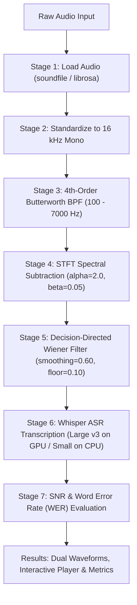

# BANAAG
> **"Defeating noise. Delivering Clarity"**  
> *A Speech Enhancement and Whisper AI Evaluation Web Application for Low-Resource Cebuano Audio.*

Banaag applies a cascaded 3-stage Digital Signal Processing (DSP) pipeline to clean noisy Cebuano speech recordings and evaluates speech recognition performance using fine-tuned OpenAI Whisper models, calculating Signal-to-Noise Ratio (SNR) improvements and Word Error Rate (WER) reductions.

---

## Course and Team Information

* **Course**: CPE027 Digital Signal Processing — Final Project (CPE41S2)
* **Team (Group 1)**:
  * Adia, James Russel
  * Magistrado, Aira Pauleen
  * Peñas, John Patrick
  * San Juan, Edson Ray
  * Santos, Ma. Kassandra Nicole

---

## Quick Start Guide

### 1. Prerequisites
Ensure you have **Python 3.10 to 3.13** installed.

### 2. Setup Virtual Environment
Run the following in your terminal from the project root:

```powershell
# Create the virtual environment
python -m venv .venv

# Activate the virtual environment
.venv\Scripts\Activate.ps1       # Windows PowerShell
# source .venv/bin/activate       # Mac / Linux

# Install required dependencies
pip install -r requirements.txt
```

### 3. Run the Application
```powershell
python main.py
```

* Open your browser and go to: **[http://localhost:5000](http://localhost:5000)**
* Interactive API Documentation (Swagger UI) is available at: **[http://localhost:5000/docs](http://localhost:5000/docs)**

---

## Testing with Sample Audio

To test the full pipeline and automatic Word Error Rate (WER) scoring:

1. **Extract Cebuano test recordings and ground truth transcripts:**
   ```powershell
   python extract_test_samples.py
   ```
   * Streams samples from [`SilencioNetwork/cebuano-speech`](https://huggingface.co/datasets/SilencioNetwork/cebuano-speech) on Hugging Face.
   * Saves `.wav` audio files into `test_samples/`.
   * Automatically saves corresponding ground-truth transcripts into `references/` (e.g., `ceb_sample_001_reference.txt`).

2. **Open [http://localhost:5000](http://localhost:5000)** in your browser.
3. Drag and drop any `.wav` file from `test_samples/` into the upload box.
4. The web app automatically detects the matching reference text in `references/`.
5. Click **START** to view the real-time 7-stage processing tracker, waveform comparisons, and metrics.

---

## The 7-Stage Pipeline



1. **Load Audio**: Reads standard audio formats (`WAV`, `FLAC`, `MP3`, `M4A`).
2. **Standardize to 16 kHz Mono**: Converts multi-channel audio to mono and resamples via polyphase filtering.
3. **Butterworth Band-Pass Filter**: Zero-phase (`sosfiltfilt`) 4th-order filter restricting frequencies between 100 Hz and 7000 Hz.
4. **Spectral Subtraction**: STFT-based magnitude spectral subtraction using the quietest 20% frames to estimate noise, applying over-subtraction ($\alpha=2.0$) and a spectral floor ($\beta=0.05$).
5. **Decision-Directed Wiener Filter**: Adaptive frame-by-frame Ephraim-Malah a-priori SNR tracking ($a=0.60$, minimum gain floor $0.10$) with peak clipping guard.
6. **Whisper Speech-to-Text**: Automatically chooses:
   * **Whisper Large v3 (FP16)** on CUDA GPUs for maximum accuracy (`sapinsapin/whisper-large-v3-pld-ceb-norm`).
   * **Whisper Small (FP32)** on CPUs with thread throttling to maintain system responsiveness (`sapinsapin/whisper-small-pld-ceb`).
   * Emits timestamped 25-second chunked segments.
7. **SNR & WER Scoring**:
   * Estimates SNR in dB comparing enhanced speech to original speech.
   * Calculates Word Error Rate (%) comparing both baseline (noisy) and enhanced speech against ground truth text using `jiwer`.

---

## Repository Structure

```text
Banaag_DSP/
├── main.py                     # Root FastAPI entry point & orchestration server
├── requirements.txt            # Python dependencies
├── extract_test_samples.py     # Script to stream and save Hugging Face test audio & references
├── .gitignore                  # Git ignore rules (prevents pushing heavy audio, caches & venvs)
├── README.md                   # Project documentation
│
├── frontend/                   # Web User Interface
│   └── index.html              # Single-page UI (Canvas waveforms, audio player, 7-stage tracker)
│
├── backend/                    # DSP & Machine Learning Modules
│   ├── config.py               # Tunable DSP parameters, sample rate, and model IDs
│   ├── audio_io.py             # Audio decoding, downmixing & polyphase resampling
│   ├── dsp.py                  # Butterworth BPF, STFT Spectral Subtraction & Wiener filter
│   ├── asr.py                  # Whisper ASR model loading and chunked transcription
│   └── metrics.py              # Normalized WER, STFT SNR estimation & reference matching
│
├── references/                 # Ground-truth transcripts (e.g., ceb_sample_001_reference.txt)
├── test_samples/               # Local test audio files (ignored by Git)
└── work/                       # Temporary workspace for uploads and processed WAVs (ignored by Git)
```

---

## API Endpoints

| Method | Endpoint | Description |
| :--- | :--- | :--- |
| `GET` | `/` | Serves the web UI (`frontend/index.html`) |
| `POST` | `/api/jobs` | Accepts audio file upload & optional reference text; starts 7-stage worker |
| `GET` | `/api/jobs/{id}` | Polled every 600 ms for stage progress, timing, and results |
| `GET` | `/api/jobs/{id}/audio` | Streams the cleaned 16 kHz WAV audio file |
| `DELETE` | `/api/jobs/{id}` | Cancels an ongoing processing job |
| `GET` | `/api/asr/status` | Returns hardware info (GPU/CPU) and model status |
| `GET` | `/docs` | Interactive Swagger API documentation |
